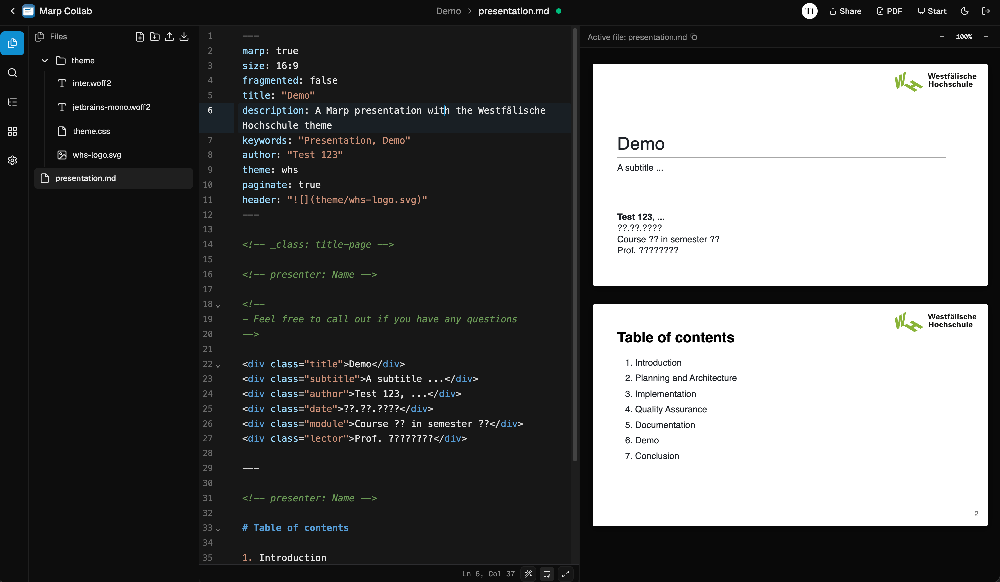

# <div align="center"> <br>MarpCollab</div>

<div align="center">
Realtime collaboration editor for marp presentations<br><br>

<a href="https://github.com/alex289/marp-collab/blob/main/LICENSE"></a>
<a href="https://github.com/alex289/marp-collab/releases"></a>
<a href="https://github.com/alex289/marp-collab/issues"></a>


</div>

MarpCollab is a realtime collaboration editor for [Marp](https://marp.app/) presentations. It allows multiple users to edit the same presentation simultaneously, with changes reflected in real-time.

## Include Markdown files

Reuse slides from another `.md` or `.markdown` file in the same project with a standalone comment:

```markdown
<!-- @include: chapters/intro.md -->
```

Paths are relative to the file containing the comment, including for nested includes. Leading YAML frontmatter in included files is stripped. Preview, slide overview, presentation navigation and PDF export use the expanded content; the editor keeps the original comments. Clicking an included slide jumps to its include comment in the main file.

Included content refreshes every three seconds and PDF export reads active edits. Missing files, cycles and invalid paths produce inline errors. Expansion allows up to 10 nested levels, 100 includes and 1,000,000 total source characters. Comments in fenced or indented code examples are left unchanged.

Image paths in included content currently resolve relative to the main deck. Slide reordering is disabled for decks with includes; edit the source files to reorder those slides.

## AI presentation editing with MCP

Connect an MCP-compatible AI client to `${URL}/mcp` using Streamable HTTP. For local
development the URL is `http://localhost:5173/mcp`. Sign in with your usual provider
and approve the requested permissions. Public deployments require HTTPS and the
`URL` setting must match the address used by the client. No model API key is needed
in MarpCollab: the connected AI client generates the Markdown.

The server supports current MCP requests and stateless 2025 Streamable HTTP clients.
Clients can identify themselves with Client ID Metadata Documents (CIMD). For older
clients that require Dynamic Client Registration (DCR), explicitly set
`MCP_ALLOW_DYNAMIC_CLIENT_REGISTRATION=true` and restart. This opens client
registration to unauthenticated clients; accessing presentations still requires
user login and consent. Registration is disabled by default.

Available tools are `list_projects`, `list_files`, `read_presentation`,
`create_presentation`, and `edit_presentation`. Create a project in the app first,
then ask your assistant, for example: “Create a ten-slide introduction to Kubernetes
in my Training project.” The server also exposes a Marp authoring guide.

The OAuth scopes are `presentations:read`, `presentations:write`, and optional
`offline_access` for refresh tokens. Request both presentation scopes to create or
edit decks; read-only tokens expose only the reading tools. Access covers owned and
shared projects and is checked against current project permissions on every call.
The server exposes no project deletion or collaborator-management tools.

Edits synchronize with open editors and require the revision returned by
`read_presentation`. Stale revisions are rejected so the assistant can reread and
reapply its changes. New files never overwrite existing files. OAuth and signing
key tables are added automatically by the database migration on startup.

Reverse proxies must forward `/mcp`, `/.well-known/*`, and `/api/v1/auth/*` to the
backend. The development Vite proxy already forwards these paths. MCP requests use
OAuth access tokens; existing browser API routes continue to require session cookies.

Implementation follows the [Better Auth MCP integration](https://better-auth.com/docs/plugins/mcp)
and the [official MCP TypeScript SDK](https://ts.sdk.modelcontextprotocol.io/v2/).

## Getting Started

MarpCollab is self-hosted with Docker Compose. You need Docker with the Compose plugin and an OAuth provider to log in with.

1. Grab the [`docker-compose.yml`](https://github.com/alex289/marp-collab/blob/main/docker-compose.yml) into an empty directory:

   ```sh
   mkdir marp-collab && cd marp-collab
   curl -O https://raw.githubusercontent.com/alex289/marp-collab/refs/heads/main/docker-compose.yml
   ```

2. Create a `.env` file next to it (See [Configuration](#configuration) for all available settings)

3. Start it:

   ```sh
   docker compose up -d
   ```

The app is available at http://localhost:8787. The database and all project files live in `./data`, so back up that directory. The bundled `gotenberg` service handles PDF export and needs no configuration.

To update, pull the new image and recreate the containers:

```sh
docker compose pull && docker compose up -d
```

> [!NOTE]
> The port is published on `127.0.0.1` only. To expose MarpCollab publicly, put it behind a reverse proxy that terminates TLS and set `URL` to the public address.

### Configuration

All settings are configured via environment variables.

#### Basic

| Variable      | Default | Description                                                                                                       |
| ------------- | ------- | ----------------------------------------------------------------------------------------------------------------- |
| `URL`         | —       | Public base URL of the app (e.g. `https://example.com`). Used by Better Auth as the trusted origin. **Required.** |
| `AUTH_SECRET` | —       | Random secret used by Better Auth to sign sessions. **Required.**                                                 |

PDF export requires Gotenberg 9; the Compose files use version 9.4.0. Custom deployments must upgrade their Gotenberg service alongside the app.

Register `${URL}/api/v1/auth/callback/<n>` as the redirect URI with each OAuth provider (for example, `https://slides.example.com/api/v1/auth/callback/0`). When upgrading from Better Auth 1.6, replace the previous `/api/v1/auth/oauth2/callback/<n>` redirect URI and restart any sign-ins in progress. Providers must support PKCE, which is now enabled by default.

At least one OAuth provider must be configured. Each provider is identified by a numeric index `<n>` starting at `0`:

| Variable                          | Default                | Description                                                            |
| --------------------------------- | ---------------------- | ---------------------------------------------------------------------- |
| `AUTH_PROVIDER_<n>_NAME`          | —                      | Display name shown on the login page. **Required.**                    |
| `AUTH_PROVIDER_<n>_CLIENT_ID`     | —                      | OAuth client ID. **Required.**                                         |
| `AUTH_PROVIDER_<n>_CLIENT_SECRET` | —                      | OAuth client secret. **Required.**                                     |
| `AUTH_PROVIDER_<n>_DISCOVERY_URL` | —                      | OIDC discovery URL (`.well-known/openid-configuration`). **Required.** |
| `AUTH_PROVIDER_<n>_SCOPES`        | `openid,email,profile` | Comma-separated OAuth scopes.                                          |

#### Advanced

These settings are not required to be set, but can be used to customize the app's behavior.

| Variable           | Default            | Description                                                                                  |
| ------------------ | ------------------ | -------------------------------------------------------------------------------------------- |
| `PORT`             | `8787`             | Port the HTTP server listens on.                                                             |
| `HOSTNAME`         | _(all interfaces)_ | Hostname/IP to bind the server to.                                                           |
| `NODE_ENV`         | —                  | Set to `development` to enable dev mode (disables static frontend serving).                  |
| `DATA_PATH`        | `./data`           | Directory for the SQLite database and all project files.                                     |
| `MAX_BODY_SIZE_MB` | `200`              | Maximum allowed HTTP request body size in megabytes. Increase for larger file/video uploads. |
| `LOG_LEVEL`        | `info`             | Log level (`trace`, `debug`, `info`, `warn`, `error`, `fatal`).                              |

## Contribute

You're very welcome to contribute to MarpCollab! Please follow the [contribution guide](https://github.com/alex289/marp-collab/blob/main/CONTRIBUTING.md) to get started.
