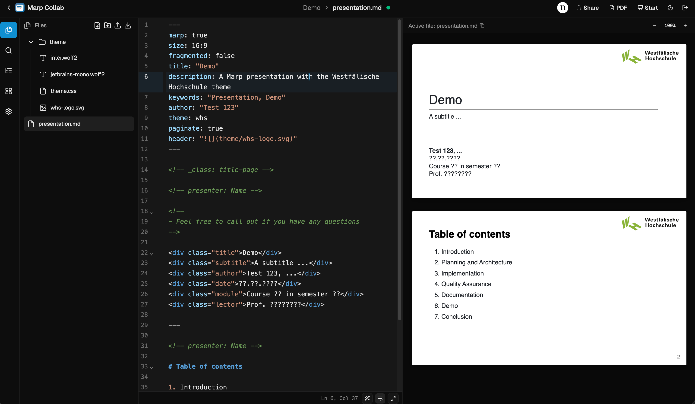

# <div align="center"> <br>MarpCollab</div>

<div align="center">
Realtime collaboration editor for marp presentations<br><br>

<a href="https://github.com/alex289/marp-collab/releases"><picture><source media="(prefers-color-scheme: dark)" srcset="https://shieldcn.dev/github/alex289/marp-collab/release.svg?logo=github&mode=dark&size=sm&variant=outline"></picture></a>
<a href="https://github.com/alex289/marp-collab/issues"><picture><source media="(prefers-color-scheme: dark)" srcset="https://shieldcn.dev/github/alex289/marp-collab/issues.svg?logo=github&mode=dark&size=sm&variant=outline"></picture></a>
<a href="https://github.com/alex289/marp-collab/blob/main/LICENSE"><picture><source media="(prefers-color-scheme: dark)" srcset="https://shieldcn.dev/github/alex289/marp-collab/license.svg?logo=opensourceinitiative&logoColor=%233da639&mode=dark&size=sm&variant=outline"></picture></a>


</div>

MarpCollab is a realtime collaboration editor for [Marp](https://marp.app/) presentations. It allows multiple users to edit the same presentation simultaneously, with changes reflected in real-time.

## Features

- **Realtime collaboration** – edit decks together with live preview
- **Presenter view** – speaker notes, timer, synced audience windows and [live demos](docs/live-demos.md)
- **Markdown includes** – reuse slides from other files with `<!-- @include: intro.md -->` ([docs](docs/markdown-includes.md))
- **Tailwind CSS** – style slides with utility classes via `tailwind: true` ([docs](docs/tailwind.md))
- **Slide transitions** – animate slide changes with `transition: fade` or keyframes from your theme ([docs](docs/slide-transitions.md))
- **Git sync** – pull from and push to a Git repository
- **PDF export**
- **AI editing via MCP** – let AI assistants create, edit and version decks at `${URL}/mcp` ([docs](docs/mcp.md))

## Getting Started

MarpCollab is self-hosted with Docker Compose. You need Docker with the Compose plugin and an OAuth provider to log in with.

1. Grab the [`docker-compose.yml`](https://github.com/alex289/marp-collab/blob/main/docker-compose.yml) into an empty directory:

   ```sh
   mkdir marp-collab && cd marp-collab
   curl -O https://raw.githubusercontent.com/alex289/marp-collab/refs/heads/main/docker-compose.yml
   ```

2. Create a `.env` file next to it (See [Configuration](#configuration) for all available settings)

3. Start it:

   ```sh
   docker compose up -d
   ```

The app is available at http://localhost:8787. The database and all project files live in `./data`, so back up that directory. The bundled `gotenberg` service handles PDF export and needs no configuration.

To update, pull the new image and recreate the containers:

```sh
docker compose pull && docker compose up -d
```

> [!NOTE]
> The port is published on `127.0.0.1` only. To expose MarpCollab publicly, put it behind a reverse proxy that terminates TLS and set `URL` to the public address.

### Configuration

All settings are configured via environment variables.

#### Basic

| Variable      | Default | Description                                                                                                       |
| ------------- | ------- | ----------------------------------------------------------------------------------------------------------------- |
| `URL`         | —       | Public base URL of the app (e.g. `https://example.com`). Used by Better Auth as the trusted origin. **Required.** |
| `AUTH_SECRET` | —       | Random secret used by Better Auth to sign sessions. **Required.**                                                 |

PDF export requires Gotenberg 9; the Compose files use version 9.4.0. Custom deployments must upgrade their Gotenberg service alongside the app.

Register `${URL}/api/v1/auth/callback/<n>` as the redirect URI with each OAuth provider (for example, `https://slides.example.com/api/v1/auth/callback/0`). When upgrading from Better Auth 1.6, replace the previous `/api/v1/auth/oauth2/callback/<n>` redirect URI and restart any sign-ins in progress. Providers must support PKCE, which is now enabled by default.

At least one OAuth provider must be configured. Each provider is identified by a numeric index `<n>` starting at `0`:

| Variable                          | Default                | Description                                                            |
| --------------------------------- | ---------------------- | ---------------------------------------------------------------------- |
| `AUTH_PROVIDER_<n>_NAME`          | —                      | Display name shown on the login page. **Required.**                    |
| `AUTH_PROVIDER_<n>_CLIENT_ID`     | —                      | OAuth client ID. **Required.**                                         |
| `AUTH_PROVIDER_<n>_CLIENT_SECRET` | —                      | OAuth client secret. **Required.**                                     |
| `AUTH_PROVIDER_<n>_DISCOVERY_URL` | —                      | OIDC discovery URL (`.well-known/openid-configuration`). **Required.** |
| `AUTH_PROVIDER_<n>_SCOPES`        | `openid,email,profile` | Comma-separated OAuth scopes.                                          |

If Better Auth reports that discovery left no usable authorization endpoint or token exchange, check `AUTH_PROVIDER_<n>_DISCOVERY_URL` from inside the app container. It should return HTTP 200 with the provider's OIDC metadata JSON, including `authorization_endpoint` and `token_endpoint`. Verify that the container can resolve the hostname and reach it over HTTPS, and that the discovery route is accessible without login. The login page can still show the configured provider while discovery is unavailable.

#### Reverse proxy

For per-client auth rate limits, keep the app port behind your reverse proxy and have the proxy overwrite the client IP header with the verified client address. Better Auth reads `X-Forwarded-For` by default and expects a single IP. If your proxy sets a different header, such as `X-Real-IP`, set `AUTH_IP_ADDRESS_HEADER` to that header name.

If the header contains a chain of addresses, set `AUTH_TRUSTED_PROXIES` to a comma-separated list of the trusted proxy IPs or CIDR ranges in that chain. Better Auth walks the chain from right to left and uses the first untrusted address. If it cannot resolve a client IP, requests share a rate-limit bucket per auth path.

#### Advanced

These settings are not required to be set, but can be used to customize the app's behavior.

| Variable           | Default            | Description                                                                                  |
| ------------------ | ------------------ | -------------------------------------------------------------------------------------------- |
| `PORT`             | `8787`             | Port the HTTP server listens on.                                                             |
| `HOSTNAME`         | _(all interfaces)_ | Hostname/IP to bind the server to.                                                           |
| `NODE_ENV`         | —                  | Set to `development` to enable dev mode (disables static frontend serving).                  |
| `DATA_PATH`        | `./data`           | Directory for the SQLite database and all project files.                                     |
| `MAX_BODY_SIZE_MB` | `200`              | Maximum allowed HTTP request body size in megabytes. Increase for larger file/video uploads. |
| `LOG_LEVEL`        | `info`             | Log level (`trace`, `debug`, `info`, `warn`, `error`, `fatal`).                              |

## Contribute

You're very welcome to contribute to MarpCollab! Please follow the [contribution guide](https://github.com/alex289/marp-collab/blob/main/CONTRIBUTING.md) to get started.
