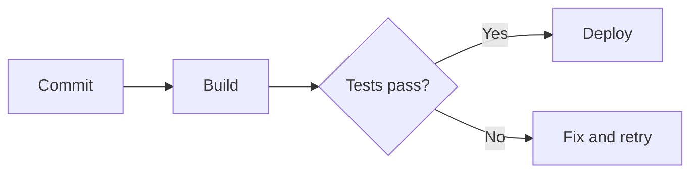
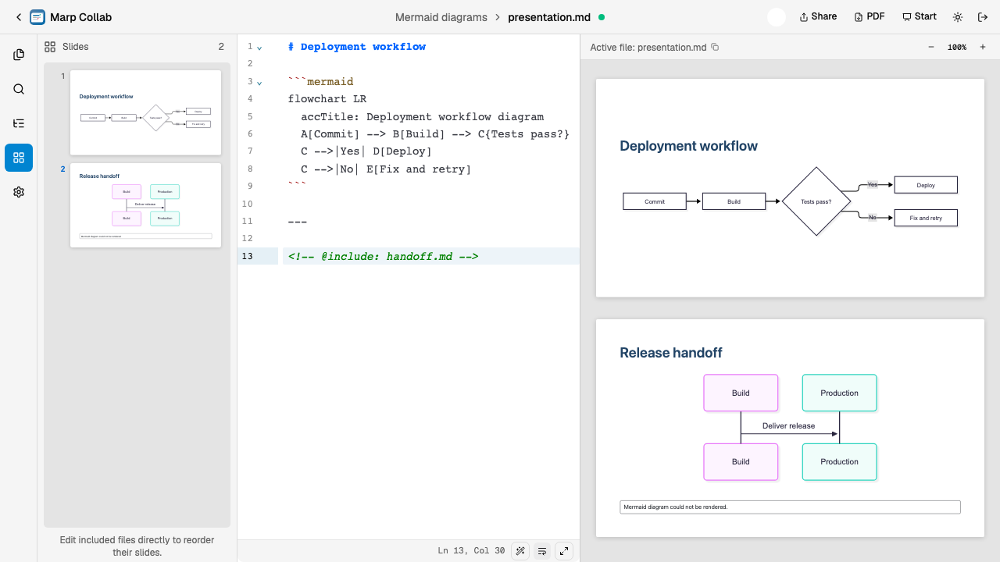

# Mermaid diagrams

Use a fenced `mermaid` block anywhere you can place a Markdown code block on a slide.

````markdown
# Deployment workflow


````

Diagrams fit the slide automatically and appear in the editor preview, slide thumbnails, presenter and audience views, and PDF exports. The source stays in Markdown, including when the block comes from an [included file](markdown-includes.md). Invalid or incomplete diagrams show an error in place while other slide content still renders.

Use `accTitle:` to give a diagram an accessible name in the browser. Diagrams are static SVG images. Diagram settings are managed by the app.


