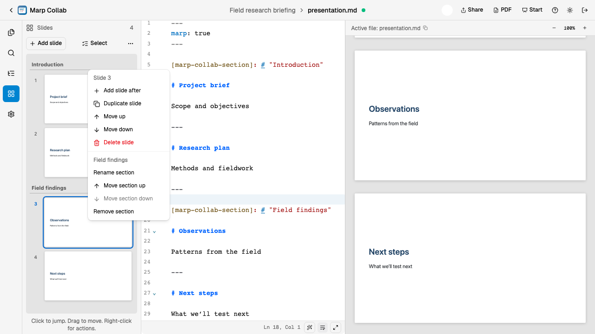

# Slide overview

Open **Slides** in the workspace sidebar. Click a thumbnail or press Enter on its number to jump to the slide in the editor. Drag a thumbnail to reorder it. Right-click a thumbnail or press Shift+F10 on its number to open its actions. The toolbar also offers **Add slide** and **Slide actions** for the active slide.

Choose **Select** to select several thumbnails. Shift-click selects a range, and clicking a section name selects its slides. Drag a selected thumbnail to move the selection together, or open **Selection actions** from the toolbar or a selected thumbnail to move or delete it. Undo in the editor reverses the whole action.

Use **Start section here** to name a group that runs from the active slide to the next section. Click a section name to jump to its first slide. In the **Slide actions** menu, you can rename the active section, move it past an adjacent named section, or remove its label while keeping its slides. Section names are stored at the start of their first slide as Markdown reference definitions. Marp omits those definitions from rendered slides and speaker notes.

Read-only viewers can still use thumbnail navigation. Decks with Markdown includes or implicit heading-based slide breaks use source editing for slide changes.

Put deck-wide directives in the YAML front matter to keep them independent of slide edits. The overview stops edits that would change a deck-wide setting.

